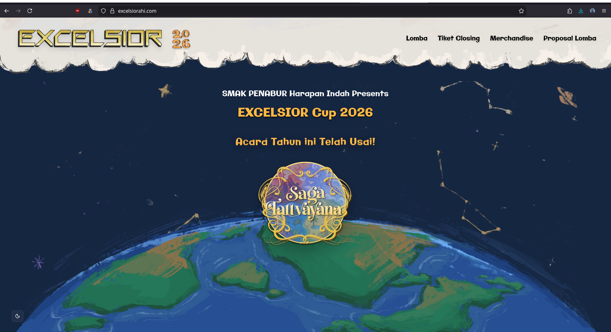
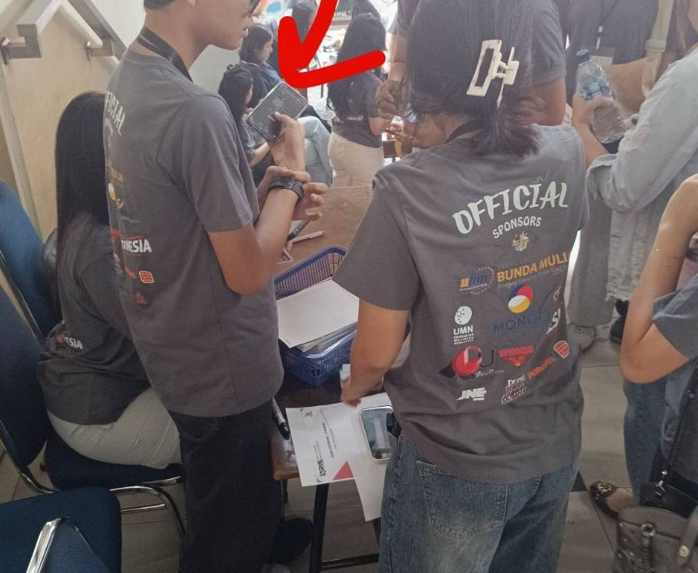

Wow, I can't believe that 2024 was 2 years ago. Insane how time flies. I blink and suddenly I'm here leading the tech team in my _last_ year here. 😭

---

[EXCELSIOR](/blog/excelsior), my high school's annual competition event, have always had a special place in my heart.

Never have I met so many talented people from my school who worked with me pursuing the same goal of maintaining a piece of software—something I've always dreamed of doing with IRL friends. But that was 2024, two years ago.

The next year, I chose to be part of the design team because I wanted to try something different. Besides that, I also knew the people who were part of the IT team, and I decided not to join them because I don't particularly vibe with them (they're seniors I've worked with in another committee). Too sad that I couldn't work with my previous tech team anymore because all of the members have graduated, except for me. The feeling of being left after your friends graduated is so heartbreaking.

But this year, in 2026, I'm back in the tech business in order to make our past dream of a website with clean code and type safety come to fruition!! The new website is oh-so-much better and I actually enjoyed writing it instead of dreading all the time because "I couldn't remember the endpoint path lol" or "why can't I type arrays peacefully!?"[^1].

# The Old Website

I discussed our old website in depth [in this article about 2024's EXCELSIOR](/blog/excelsior). Basically, it is THE definition of a spaghetti codebase, and we've been longing to rewrite it. Here are some example of the spaghetti evidences:

- It had 304834 lines of code (per [Onefetch](https://github.com/o2sh/onefetch)). Let me spell it out: three hundred four thousand eight hundred and thirty four lines of code, tracked by git. I wouldn't even dare to try to clean it up.
- PHP but without framework. Yup, just bare PHP. Very fun /s
- Didn't use a version control system until 2024 during my first year in the tech division (it was first written in 2019 or 2020).
- Copy-pasted things EVERYWHERE where they could've been modularized.
- SQL Injection vulnerabilities???
    ```php
    $data = mysqli_query($conn,"SELECT * FROM User WHERE (Username='$user' OR Email='$user') and Password='$pass'");
    ```

- Poorly manually implemented authentication for login, including one user + one password for ALL purposes.
- No form validation on back-end. The only thing validating being the browser's native form field validation on client's side.
- Credentials are in a PHP file instead of environment variable?!
- No way to recreate the database schema easily or do type-safe queries as the schema basically lives entirely outside the codebase.
- Bugs—lots of them.
- Many unhandled edge cases.

Unfortunately, even though the codebase has been retired, I don't think I can show it to the public because it doesn't have a license and I don't know the original creator. I really wish that you can read it yourselves though :"D

# The Long Awaited Rewrite



<p style="text-align: center;">The new website.</p>

As I said before, back in 2024, our tech team wanted to do a website rewrite considering how annoying our old code was to maintain.

I only started doing the rewrite earlier this year, in April 2026. Unfortunately, we didn't have other website maintainers so I was all on my own back then. We later did get new members to maintain the website—which is great—but it was quite after most things have been implemented. But still, the new website still needs lots of work so I highly appreciate the new members coming in.

The new website, which is also hosted under [excelsiorahi.com](https://excelsiorahi.com), I think is really delightful to maintain. I used [SvelteKit](https://svelte.dev/docs/kit/introduction) with TypeScript, as well as a bunch of other great libraries like [Drizzle ORM](https://orm.drizzle.team/) and [Better Auth](https://better-auth.com/) so that dummy me can focus on the important stuff and don't need to implement high-risk features like authentication from complete scratch (which is tricky to do regardless your experience anyway). I tried to get rid of all the other annoyances from the old site too, and so far it's great:

- Only 16630 lines of code so far (5.4% of the original amount), and it already has everything we had from 2 years ago!
- Handmade art for the website! Files are still big even with WebP + max compression though, so we're still working on decreasing the load time.
- FULLY responsive!
- Uses [shadcn-svelte](https://www.shadcn-svelte.com/) for no-boilerplate yet beautiful and consistent UI. It saves a LOT of css, as well as increasing modularity.
- Uses GitHub actions to lint and check code, as well as to automatically build and deploy the website to our server.
- Uses Git from the start.
- Uses an ORM, so we get type-safe queries. The database schemas can be applied quickly as well and lives with the codebase, not outside of it.
- Form validation that relies on one source of truth, being done in front-end as well as back-end. [Superforms](https://superforms.rocks/) helped a ton with it!
- Credentials in environment variable files, as how they're supposed to be. Phew.
- A lot lot of modularization. A lot of things are reused whenever possible.
- Heaps of UX improvements, such as actually having table pagination (yes we didn't have it before for some reason).
- I'd say, pretty secure login method for the admin site. I used magic links sent to their email to log users in so I don't have to deal with people forgetting their passwords or force people to use 2FA.
- User management! I can assign privileges as needed to each user of the admin site.

Of course, this is no small feat. And this is also apparent with my... coding time. It took me about 180 hours of coding, with 84 active days to reach the same core functionality as the old site (I tracked [the hours here](https://hackatime.hackclub.com/my/projects/excelsiorahi-rewrite)). As a student in grade 12, this is sooo on the edge of what I can pump out. I even remember that time I spent 26 hours a week for this, I don't think I've ever spent such dedication to a piece of software before. But I'm still happy to have made the decision to do the rewrite because I learned soooo much from it.

I think 60 to 70 of the hours were spent just to make the [registration and ticket forms right](/blog/infinite-power-web-forms), since I recalled that it was the most buggy part of our site from 2 years ago where things fail to be submitted and we couldn't figure out why—so I wanted to do it right this time. Even though at the end there were still some file upload issues... because I sort of sent all the files in one POST request (I regret not implementing file pre-upload ugh), I'd still say it's much more successful than last year. There were maybe just around 5 reported sign-ups with file upload issues, all of which were easily solvable thanks to our PR team helping them by uploading their files. To compare, there were 479 competition sign-ups in total, which comprises 1961 participant details.

Ticket forms, on the other hand, were very very successful though—with only some minor pricing info email issues at the start and maybe 2 people that I had to help with file submission (some people's external browser view doesn't support file uploading apparently). There were a total of 847 ticket purchases made on the website, which is surreal!


# The Joy of Seeing Your Software Being Used IRL: Ticketing

Beyond our registration website, we also have ticket scanning infrastructure for our closing ceremony to verify people who want to get in!


I implemented this year's ticket scanning with the same tools as the rest of our website—still SvelteKit, Typescript and the library friends. It's actually pretty easy to hook up the ticketing infrastructure to the rest of the code as the codebase was highly extensible.




<p style="text-align: center;">The ticket scanner web app :)</p>

[Two years ago](https://www.dcutes.my.id/blog/excelsior-closing-ceremony/#almost-tragic-ticketing), I talked about how the PHP ticket scanner I wrote somehow ran into a problem during the day of the event... But that's no more this year!

A while after I arrived at school, I saw the ticketing team using my ticket scanner all on their own, with no assistance needed—which is pretty surprising to me. I also saw someone joking about the QR code scanner to their friend. Kinda makes my heart fuzzy when someone enjoys a piece of software that your hands orchestrated yourselves, like it's just another software they're used to seeing, because, _won't it mean it's good!_ 😄 My boyfriend who came to visit also used the scanner seamlessly and that's low-key kinda funny[^2].


But the real joy comes when I see floods of people queuing in several lines to get their ticket (in the form of a wristband) during peak hour (i.e a while before the guest star appears). A _crazy flood_ of people waiting to see their favorite artist. And people just show up the QR code from their email, from a screenshot, or the QR they downloaded from the website.

It just feels... nice, to think that somewhere, a server ran a code that I wrote to handle 8 hundred ticket purchases without hiccups and now those people are entering the stage area thanks to the purchasing infrastructure from our tech team.

Like, I'm helping to make it more seamless for everyone and I'm proud of it.

[^1]: PHP doesn't natively support typing an array with a specific element type, so only "array" and not "array of strings" for example. Workarounds are possible but they're just not clean—so much boilerplate.
[^2]: He also handles ticketing and website on their school competition event (every school in Indonesia has this stuff). Idk what kinda coincidence this is
